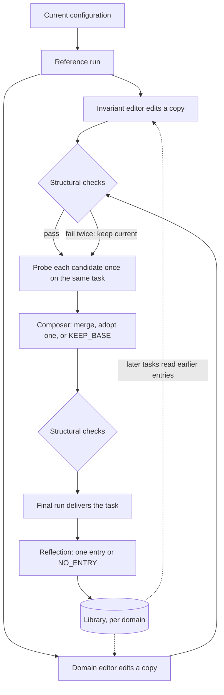

# 24 · Harness の適応

[English](README.md) · [繁體中文](README.zh-TW.md) · [简体中文](README.zh-CN.md) · **日本語** · [한국어](README.ko.md)

> loop に採点器がいなくても、improver は agent 自身の実行を手がかりに、その agent の configuration を調整できます。

セクション 21 の改善 loop は、検査役がいることを前提にしています。rubric、回帰セット、ホールドアウトセットのようなものです。
セクション 0 も、同じことを逆の側から言っています。機械が結果を検査できないなら、検査役を足すか、人を経路に残すべきだ、ということです。

終わりの決まっていないタスクには、どちらの答えも合いません。タスクは 1 件ずつ届き、模範解答は付いていません。成果物を出すまで、照らし合わせて採点できるものが何もありません。

[harness²](https://github.com/google-research/harness2) は 3 つ目の答えを試みています。harness² 自体は agent harness ではありません。
自分の loop は回しません。既存のコーディング agent を executor として起動し、その agent の configuration ファイルを編集します。

まず現在の configuration で実行します。次に別々の session にコピーを編集させ、各コピーを同じタスクで実行し、実行結果が裏付けたものだけを残します。
実行から分かるのは、その configuration がどう振る舞うかです。答えが正しいかどうかは分かりません。

その分、タスクあたりの実行回数は増えます。正しさの保証もありません。

---

## 仕組み



いちばん単純な形は、1 回きりのステップです (k = 1)。

1. **参照実行。** executor が、現在の configuration でタスクを実行します。
2. **提案。** 2 つの編集役が、それぞれ別の session でコピーを 1 つずつ編集します。進め方の編集役 (invariant editor) は、agent の仕事の進め方を受け持ちます。手順、tool の使い方、スクリプト、subagent です。
   ドメインの編集役 (domain editor) は、その分野の実務家が知っていることを受け持ちます。ドメインの事実と skill です。どちらの編集役も、編集ごとに根拠となった実行中の場面を示すよう指示されます。
3. **検査。** 各コピーに構造検査をかけます (次の小節)。
4. **probe。** 各候補を、同じモデル、同じ環境のもとで、同じタスクに対して 1 回ずつ実行します。
5. **統合。** 1 つの session が、参照実行と、各候補の diff と probe を読みます。裏付けのある編集をまとめるか、候補を 1 つそのまま採用するか、`KEEP_BASE` と答えます。
   統合役は、probe 1 回は弱い根拠にすぎないこと、参照実行が複数あるならそのうち 1 回にしか出ない欠陥はノイズであることを指示されます。
   統合役の出力も、同じ検査、やり直し、フォールバックを通ります。
6. **引き渡し。** 統合した configuration での実行が、そのまま成果物になります。

k = 1 のとき、このステップは executor の実行を 4 回、編集の session を 3 つ (編集役 2 つと統合役 1 つ) 使います。library を持つ場合は、これに振り返りの session が 1 つ加わります。

登場する部品は次のとおりです。

- **executor。** タスクをこなす、凍結された agent です。その loop、tool、重みは変わりません。
- **configuration。** executor の、編集できるファイル群です。
- **improver。** 編集役と統合役のことです。それぞれが別の session でコピーを編集し、稼働中のファイルには手を付けません。
- **選択役。** k > 1 のとき、複数の最終候補から 1 つを選ぶ session です。
- **振り返り役。** タスクから学んだことを library に書き込む session です。何も書かないこともあります。
- **edit surface。** improver が変更してよいファイルです。
- **probe。** 候補を同じタスクで 1 回実行したものです。違いを見比べるための材料で、スコアとしては扱いません。
- **library。** 採用した configuration をドメインごとにためておく保存先です。各エントリには教訓が 1 つ付きます。

### 本節の新規: edit surface とその検査

configuration は 8 つの構成要素からなり、どれもこのリポジトリのいずれかのセクションで扱っています。

| 構成要素 | 扱うセクション |
| --- | --- |
| system prompt | 10 |
| guardrail (常に読み込まれる文章の規則。permission のゲートとは別物) | 10 |
| memory ファイル | 9 |
| tool の使い方の指針 | 2 |
| subagent | 6 |
| skill | 7 |
| スクリプト | 2 |
| plugin または hook | 4 |

- **edit surface はデータとして宣言する。** executor ごとに、自分の edit surface を宣言します。一方の executor には、常に読み込まれるファイルが 4 つと plugin があります。
  もう一方はその代わりに、もっと小さい常時読み込みのファイル 1 つと、hooks ファイルを持ちます。
- **improver はコピーを編集する。** improver は専用のワークスペースで作業します。戻ってくるのは、編集された configuration のフォルダだけです。
  手法自身の prompt とゲートはワークスペースにコピーされないので、improver はそれらを編集できません。
- **検査は probe より先。** 次のどれかに当てはまるコピーは不合格です。
  - edit surface の外にあるファイルを含んでいる (ほかの不正なコピーと同じく、コピー全体が却下されます)。
  - 常に読み込まれるテキストが、サイズの上限を超えている。
  - skill に description がない。または、常に読み込まれるテキストのどこにもその skill の名前が出てこない。
  - スクリプトがコンパイルできない (スクリプトはコンパイルするだけで、実行はしません)。
  - skill が、同梱されていないスクリプトを名指ししている。
  - hooks ファイルが、executor の発火させないイベントに hook を結び付けている。
  - 採点器の判定文を含んでいる (トリップワイヤ)。
- **検査の前に 1 つだけ修復が入る。** 常に読み込まれるテキストが名前を出していない skill については、harness² はまず、上限に収まるなら trigger の行を 1 行足します。
  その検査が不合格になるのは、この修復の後だけです。
- **指示にとどまる規則もある。** improver は、変更ごとに実行時のコストを見て置き場所を選ぶよう指示されます。常に読み込まれるテキストより、skill かスクリプトを優先せよ、という指示です。
  そのとおりにしたかを検査するものはありません。
- **不正なコピーには、やり直しが 1 回。** validator のメッセージは、そのままやり直しの入力に入ります。2 回目も失敗すると現在の configuration を使い続け、「フォールバック」と記録します。
  変更のない正当なコピーは、それとは区別して「意図して維持」と記録します。

```python
def run_stage(editor, config, attempts=2):            # src/adapt.py
    feedback = None
    for n in range(1, attempts + 1):
        out = editor(dict(config), feedback)
        out = dict(config) if out == KEEP_BASE else out
        try:
            check(out)                                 # one ValueError lists every problem
        except ValueError as e:
            feedback = str(e)                          # the message rides into the retry
            continue
        return {"config": out, "fell_back": False, "kept_base": out == config, "attempts": n, "error": None}
    return {"config": dict(config), "fell_back": True, "kept_base": False, "attempts": attempts, "error": feedback}
```

edit surface は、loop の中の制御にまで届きます。一方の executor の編集できる hooks ファイルは、`PreToolUse` と `PermissionRequest` に hook を結び付けられます (セクション 4)。
つまり 1 つの編集で、executor が自分の tool 呼び出しをどうゲートするかまで変わりえます。セクション 21 のゲートの規則は、この場合にも当てはめる必要があります。

### 本節の新規: 同じ予算で幅を取るか、深さを取るか

予算は k です。その使い方には 2 つのモードがあります。

- **並列。** 同じ参照実行から 2k 個の候補を作り、それぞれを probe します。次に、互いに独立した統合を k 回行い、その結果をそれぞれ probe します。
- **逐次。** k ラウンド回します。各ラウンドでは、現在の checkpoint に対して候補を 2 つ提案して両方を probe し、統合して次の checkpoint を作り、それも probe します。
  逐次モードの `KEEP_BASE` が残すのは、その時点の checkpoint です。最初の configuration には戻りません。

どちらのモードも、executor の実行をちょうど 4k 回、編集の session (編集役と統合役) をちょうど 3k 個使います。k 回の参照実行はその中で共有されます。
フォールバックした段階も数に入り、probe も受けるので、失敗があっても消費は減りません。選択と振り返りは、この数の外で行います。

k = 1 では、どちらのモードも先ほどの 1 ステップと同じで、選択はありません。k > 1 では、選択役が k 個の最終候補の中だけから、どれがどれか分からない状態で 1 つを選びます。
並列モードでは、k 個の統合結果が最終候補です。逐次モードでは、最後の checkpoint だけでなく、すべての checkpoint が最終候補になります。

- 選択役に見えるのは、タスク、元になるファイル、そして並べ替えた id を付けた各最終候補の成果物です。configuration もラベルも見えません。
- 成果物が見せるファイルのない状態の変化であるときに限り、実行ログが見えます。
- 選ぶのは、既にある出力です。選ばれたのは採用されたということで、正しさが証明されたわけではありません。

どちらのモードにするかを決める規則はありません。モードと k は、実行の前に固定します。

### 本節の新規: タスクをまたいだ学習

タスクが終わると、振り返りの session がすべての候補を読みます。各候補の diff と probe、判断の記録、どの最終候補が選ばれたかも読みます。
書くエントリは 1 つです。採用された configuration 全体に、教訓を 1 つ添えます。教訓には、きっかけ、教訓そのもの、根拠、確信度が入ります。
各編集には判定も付けます。「役立った」「害になった」「効果は観測されず」「交絡」のどれかです。

- **採用は根拠にならない。** 選択では、configuration を伏せたまま出力を比べました。分かるのは、どの出力がいちばん良く読めたかです。どの編集が効いたかは分かりません。
- **エントリにはゲートがある。** `NO_ENTRY` は正当な答えです。きっかけ、教訓、根拠のどれかが欠けたエントリは書き込まれません。選択に失敗したら振り返りを飛ばし、何も保存しません。
- **ドメインごとに library を 1 つ。** ドメイン内のタスクは順番に実行され、それより前のタスクのエントリだけを読みます。
  index には、各エントリの構成要素ときっかけが並びます。improver は関係がありそうなものだけを開きます (セクション 9 の、まず index を読む recall)。
- **再利用とは、コピーしてもう一度 probe すること。** どのタスクも、ベースの configuration から始まります。保存された構成要素が新しいタスクに届くのは、編集役がそれを候補にコピーしたときだけです。
  その候補は、ほかの編集と同じように検査され、probe されます。前のタスクで分かった事実も、ここでは仮説として扱います。
- **実験条件ごとに library を 1 つ。** benchmark、executor、k、シード、モードのそれぞれについて、別々の library を持ちます。

### 既存の構成への組み込み方

- セクション 21 の「オンラインの実行、オフラインの学習器」は、書き換えなしでそのまま成り立ちます。executor の実行は何も編集しません。improver は別の session で、複数の実行を読んでコピーを編集します。
  採用されたコピーが使われるのは 1 つのタスクの間だけで、次のタスクはベースから始まります。タスクをまたいで持ち越すものは、すべて library を通ります。
- はっきり書いておくと、ホールドアウトセットも回帰セットもありません。ゲートは、構造検査と、同じタスクでの probe 1 回だけです。
- セクション 23 との関係では、この手法のどの session にも、rubric、スコア、検証器の出力は渡されません。それでも、開いたネットワーク越しに executor が rubric をダウンロードすれば、
  その rubric は実行ログを通じて編集役に届いてしまいます (セクション 23 の、rubric をダウンロードする失敗モード)。手法の外にいる判定器が、選択の後で、選ばれた実行を採点します。
  その判定器が参照実行を採点してよいのは、別枠のベースラインとしてだけです。判定器が書いたものは、何も手法の側に戻りません。
- セクション 3 については、executor の sandbox とネットワークの方針は configuration の外にあります。

harness² は、これらの部品を独自の名前で呼びます。このリポジトリでは、自分たちの用語をそのまま使います。

| harness² の用語 | このリポジトリでの用語 |
| --- | --- |
| harnessing | 改善 loop (セクション 21) |
| execution harness | configuration |
| improvement harness | improver の固定された prompt と、その library |
| task-level recursion | 1 つのタスクの中での適応 |
| harnessing-level recursion | タスクとタスクの間の library の更新 |
| Propose, Probe, Compose | 1 ステップ: 提案、probe、統合または維持 |
| substrate | executor |
| rollout | 参照実行または probe |
| harness improvement library | library |

---

## システム別

各システムが、過去の session をもとに agent の configuration をどう変えるか。どのシステムも、編集を反映する前にタスクで probe することはありません。

| | Claude Code | Hermes Agent | deepseek-harness |
| --- | --- | --- | --- |
| **利点** | メモは次の session から効き、追加の実行も不要。 | やり取りの多い session から、準備なしで学習。 | 実行中の session が途中で書き換わることはない。 |
| **欠点** | 後の session が読み込む前に、メモを試す手段がない。 | 後の session が読み込む前に、編集を実際に走らせて試すことはない。 | 新しいプリセットをタスクで走らせて確かめるものがない。 |
| **理由** | 残す価値のある根拠は、user による訂正と確認。 | 教訓の良し悪しは、モデルが transcript から判断できる。 | agent はファイルなので、agent にも書ける。 |
| **方法: 編集の担い手** | agent 本人と、フラグで有効になるバックグラウンドの fork。 | 稼働中の agent、レビュー役の fork、週 1 回動く管理役。 | 人が頼んだときに動く、作成用の agent。 |
| **方法: 根拠** | user による訂正と確認。probe もスコアもなし。 | transcript と使用回数。probe はなし。 | なし。プリセットは人が試す。 |
| **方法: edit surface** | fork が書けるのは memory のメモだけ。agent 本人はどのファイルでも編集可能。 | skill と memory。固定された skill には fork が書き込まない。 | プリセットのフォルダ 1 つ。制限の大半は文章で書かれているだけ。 |
| **方法: 検査** | メモには検査なし。設定、skill、subagent の編集には承認が必要。 | 形式、サイズ、パスの検査。 | 実際にマウントして確認。どの行も解決でき、起動できること。 |
| **方法: 持ち越し** | メモの index が、そのリポジトリの以後のすべての session で読み込まれる。 | 以後のすべての session が読み込む store が 1 つ。 | プリセットは id で選ぶ。新しいプリセットはコピーから始まる。 |
| **方法: 取り消し** | バージョン管理なし。メモは人が編集して直す。 | 管理役が動く前に、毎回 skill のスナップショット。memory にはなし。 | 実行中の session は自分のプリセットを使い続ける。取り消しも、また 1 つの編集。 |

---

## 失敗モード

- **同じ誤った前提を共有する候補。** どの編集役も同じモデルで同じ実行を読むので、全員が 1 つの誤った仮定をそろって受け入れることがあります。
  そうなると、意見の一致が裏付けのように見えます。緩和策: 一致は裏付けの 1 つとして扱いますが、証明とは見なしません。共有している仮定そのものを試す probe を足します。
- **たまたまの probe 1 回に引きずられる編集。** 各候補は 1 回しか実行しないので、1 回の良い結果も悪い結果もノイズかもしれません。
  緩和策: 複数の参照実行のうち 1 回にしか出ない欠陥はノイズとして扱います。1 回の probe で複数のことが変わったなら、その編集に「交絡」と印を付けます。再利用の前には、もう一度 probe します。
- **却下された編集で止まる実行。** フォールバックがないと、不正な configuration がタスクを止めるか、人を待たせます。
  緩和策: validator のメッセージを付けて 1 回だけやり直し、それでも駄目なら現在の configuration を使い続けます。「フォールバック」と「意図して維持」は分けて記録します。
- **ペイロードを運ぶ library のエントリ。** エントリにはスクリプトと hook が入っていて、コピーされた構成要素は次のタスクの executor の中で動きます。
  緩和策: エントリは信頼できないコンテンツとして扱います (セクション 3)。improver は、読んだものを決して実行しないよう指示されます。コピーも、新しい編集と同じ検査と probe を通ります。
  各 probe は、外向き通信を遮断した sandbox で実行します (セクション 3)。harness² のリリースには、そうした sandbox は含まれていません。
- **スコアが見えてしまう improver。** 根拠の中に rubric、スコア、検証器の出力が混じると、テストセットが学習用のシグナルに変わります。
  緩和策: 答えを含まない根拠、コピーしてよいものの allowlist、判定文を拒むトリップワイヤ、保存前の教訓のスキャン、
  そして executor から採点用ホストへの接続の遮断。

---

## 実行

[`src/`](src/) は 23 を引き継ぎ、次を追加します。

- [`adapt.py`](src/adapt.py): 単独のモジュールで、`loop.py` にはつないでいません。configuration はパスからテキストへの dict です。
  `SURFACE` は、許可されたパスと、常に読み込まれるテキストの上限を持ちます。`check` は、すべての問題を並べた `ValueError` を 1 つ送出します。`run_stage` はそのメッセージを付けて 1 回やり直し、駄目ならフォールバックします。
  `step` は k = 1 の 1 ステップを実行します。`run_parallel` と `run_sequential` は、k 個の最終候補と、消費を実行 4k 回と session 3k 個に保つ `Ledger` を返します。
  `Library` は、きっかけ、教訓、根拠がそろわないと `add` を通さず、index も保ちます。`retain` は後のタスクのエントリを取り除きます。
- [`test.py`](src/test.py): オフライン検査が見るのは、`check` の規則ひとつひとつ、2 回目の prompt にエラーを入れて壊れたスクリプトを直すやり直し、
  2 回失敗した後のフォールバック、そして変更のないコピーが「フォールバック」ではなく「意図して維持」と記録されることです。決定的な編集役で 1 ステップを走らせ、
  統合役に 2 つの diff と probe がどちらも見えることも確かめます。`KEEP_BASE` は入力をそのまま返し、逐次モードでは現在の checkpoint を残します。
  さらに、両モードの k = 1、2、3 で実行 4k 回と session 3k 個になること、ラベルの重複で ledger が失敗すること、やり直しで試行回数は増えても session は増えないこと、
  参照実行が最終候補に入らないことも確かめます。library の側では、きっかけ、教訓、根拠のどれかが欠けたエントリが何も書かないこと、`NO_ENTRY` も何も書かないこと、
  各タスクにはそれより前のタスクのエントリしか見えないことを確かめます。
- [`demo.py`](src/demo.py): セクション 23 の返金エピソードで、k = 1 の live ステップを 1 回実行します。executor は `run_turn` です。
  configuration の常に読み込まれるテキストを、その system prompt にします。編集役と統合役は、それぞれモデル呼び出し 1 回です。段取りは固定のコードが決め、判断はすべてモデルが下します。
  ステップの後、セクション 23 の `grade` が、引き渡された実行だけを採点します。採点器が失敗したときは UNGRADED と表示します。

`check` は harness² より厳しくしてあります。常に読み込まれるテキストが名前を出していない skill は、修復されずにそのまま検査で落ちます。
デモは executor を 4 回実行するので、「デモ 1 つにつき `run_turn` 1 回」という規則を承知のうえで曲げています。このステップ自体が、このセクションの仕組みだからです。

loop は変わりません。適応が編集するのは loop に渡すものだけで、loop そのものには手を付けません。

```bash
python sections/24-harness-adaptation/src/test.py         # offline checks, no key
uv run python sections/24-harness-adaptation/src/demo.py  # live demo, needs a key
```

---

## 出典

- [harness² source](https://github.com/google-research/harness2) の `1cfe254` (Apache-2.0): `harness2/core/tree.py` (edit surface と検査)、
  `harness2/core/recursion.py` (1 ステップ、1 回だけのやり直し、並列と逐次)、`harness2/core/ledger.py` (実行 4k 回、session 3k 個)、
  `harness2/core/selection.py` (伏せたままの選択、振り返り)、`harness2/core/library.py` (ドメインごとの library、前のタスクのエントリだけを読む)、
  `harness2/core/schedule.py` (タスクごとのベースの configuration、ドメイン内の順序)、`harness2/cli/_common.py` (実験条件ごとに 1 つの library)、
  `harness2/core/context.py` (ファイルとして渡す根拠、判定文のトリップワイヤ)、`harness2/core/proposer.py` (ワークスペースへのコピー)、
  `harness2/core/prompts.py` (既定の `adapt` パック: 編集役の担当範囲、統合役の規則、`KEEP_BASE`、`NO_ENTRY`)、
  `harness2/substrate/opencode.py` と `harness2/substrate/codex.py` (executor ごとの edit surface)。
- [harness² paper](https://arxiv.org/abs/2610.14224) v1: なぜこの手法が要るのか (終わりの決まっていないタスクには正解がないこと、2 段階の改善、凍結された重み)。
  論文とコードが食い違う箇所では、このセクションはコードに従います。論文の JobBench の実行は別の `tts` prompt パックを使っていますが、このセクションが説明するのは既定の `adapt` パックです。
  論文の benchmark の数値は著者の報告によるもので、ここでは繰り返しません。
- [Claude Code source backup](https://github.com/yasasbanukaofficial/claude-code) の v2.1.88: `memdir/`、`services/extractMemories/`、`services/autoDream/`、
  `utils/permissions/filesystem.ts`。バックグラウンドの fork は feature flag の後ろにあり、一般の user に対する既定値は確認できていません。
  社内向けの機能と、固定したバージョンより後の機能は扱っていません。
- [Hermes Agent source](https://github.com/NousResearch/hermes-agent) の v2026.7.1: `agent/background_review.py`、`tools/skill_manager_tool.py`、
  `tools/memory_tool.py`、`agent/curator.py`、`agent/curator_backup.py`。
- [deepseek-harness source](https://github.com/deepseek-ai/deepseek-harness) の `dsh-v0.1.0-rc.7`: `packages/preset/agent-presets/`
  (README、`src/mount.ts`、`src/authoring.ts`)、それに `apps/cli/config/agent-presets/` にある `cordis` という作成用のプリセット。
