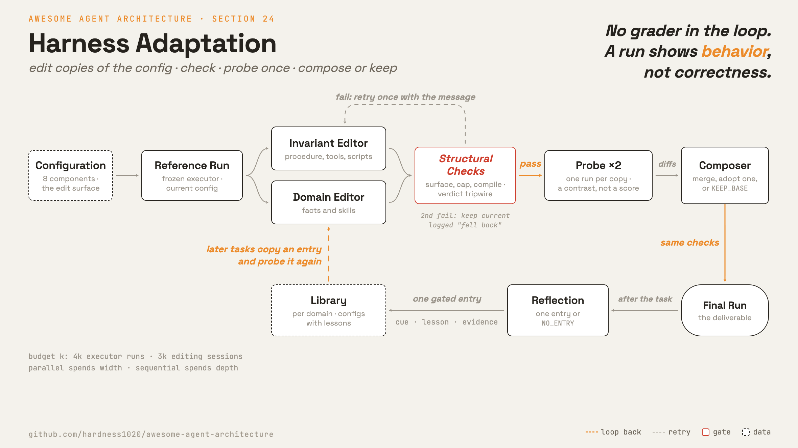

# 24 · Harness 적응

[English](README.md) · [繁體中文](README.zh-TW.md) · [简体中文](README.zh-CN.md) · [日本語](README.ja.md) · **한국어**

> loop에 채점기가 없어도, improver는 agent가 직접 남긴 실행을 근거로 그 agent의 configuration을 조정할 수 있습니다.

섹션 21의 개선 loop는 검사기가 있다고 가정합니다. rubric, 회귀 세트, 홀드아웃 세트 같은 것입니다.
섹션 0도 반대쪽에서 같은 말을 합니다. 기계가 결과를 검사할 수 없다면 검사기를 추가하거나 사람을 경로에 남겨 두라고 합니다.

열린 task는 두 답 어디에도 맞지 않습니다. 이런 task는 정답지 없이 하나씩 들어옵니다. 결과물이 나가기 전에는 대고 채점할 기준이 아무것도 없습니다.

[harness²](https://github.com/google-research/harness2)에서는 세 번째 답을 시도합니다. harness² 자체는 agent harness가 아닙니다.
자기 loop도 돌리지 않습니다. 기존 coding agent를 executor로 띄우고, 그 agent의 configuration 파일을 고칩니다.

먼저 현재 configuration으로 실행합니다. 별도의 session들이 사본을 고치게 하고, 각 사본을 같은 task에서 실행한 뒤, 실행 결과가 뒷받침하는 것만 남깁니다.
실행으로 알 수 있는 것은 configuration이 어떻게 동작하는지입니다. 답이 맞는지는 알 수 없습니다.

대가도 있습니다. task마다 실행 횟수가 늘어나고, 결과가 맞다는 보장은 없습니다.

---

## 메커니즘



가장 단순한 버전은 단계 하나입니다(k = 1):

1. **참조 실행.** executor가 현재 configuration으로 task를 실행합니다.
2. **제안.** 편집기 둘이 각자 자기 session에서 사본을 하나씩 고칩니다. 불변 요소 편집기는 agent가 일하는 방식을 맡습니다. 절차, tool 사용, script, subagent입니다.
   도메인 편집기는 실무자가 아는 것을 맡습니다. 도메인 사실과 skill입니다. 두 편집기 모두 편집마다 그 근거가 된 실행 속 순간을 인용하라고 지시받습니다.
3. **검사.** 각 사본에 구조 검사를 돌립니다(바로 아래 절).
4. **Probe.** 각 후보를 같은 task에서, 같은 모델과 같은 환경으로 한 번씩 실행합니다.
5. **조합.** session 하나가 참조 실행과 함께 각 후보의 diff와 probe를 읽습니다. 그리고 근거가 뒷받침하는 편집을 병합하거나, 후보 하나를 채택하거나, `KEEP_BASE`로 답합니다.
   조합기는 probe 한 번을 약한 근거로 다루고, 참조 실행이 여럿일 때 그중 하나에서만 보인 결함은 잡음으로 보라고 지시받습니다.
   조합 결과도 같은 검사, 재시도, 폴백을 거칩니다.
6. **전달.** 조합한 configuration으로 한 실행이 곧 결과물입니다.

k = 1에서 이 단계는 executor 실행 네 번과 편집 session 세 개(편집기 둘, 조합기 하나)를 씁니다. library를 둔다면 회고 session이 하나 더 듭니다.

움직이는 부품은 다음과 같습니다:

- **Executor.** task를 수행하는, 동결된 agent입니다. loop, tool, 가중치는 절대 바뀌지 않습니다.
- **Configuration.** executor에서 고칠 수 있는 파일들입니다.
- **Improver.** 편집기들과 조합기입니다. 각각 별도의 session이며, 사본만 고치고 실제로 쓰이는 파일은 건드리지 않습니다.
- **선택기.** k > 1일 때 여러 최종 후보 가운데 하나를 고르는 session입니다.
- **회고기.** task에서 배운 것을 library에 적거나, 아무것도 적지 않는 session입니다.
- **Edit surface.** improver가 고쳐도 되는 파일들입니다.
- **Probe.** 후보 하나를 같은 task에서 한 번 실행하는 것입니다. 대비로 읽을 뿐, 점수로는 절대 읽지 않습니다.
- **Library.** 채택된 configuration을 교훈과 함께 도메인별로 모아 두는 곳입니다.

### 새로 추가: edit surface와 그 검사

configuration은 구성 요소 여덟 개로 이루어지고, 각각을 다루는 섹션이 이 저장소에 있습니다:

| 구성 요소 | 다루는 섹션 |
| --- | --- |
| system prompt | 10 |
| 가드레일(항상 불러오는, 글로 적은 규칙. permission gate가 아님) | 10 |
| memory 파일 | 9 |
| tool 사용 안내 | 2 |
| subagent | 6 |
| skill | 7 |
| script | 2 |
| plugin 또는 hook | 4 |

- **edit surface는 데이터입니다.** executor마다 자기 edit surface를 선언합니다. 한쪽 executor에는 항상 불러오는 파일 넷과 plugin이 있습니다.
  다른 쪽에는 항상 불러오는 파일이 더 작은 것 하나뿐이고, plugin 대신 hooks 파일이 있습니다.
- **improver는 사본을 고칩니다.** improver는 자기만의 작업 공간에서 일합니다. 거기서 돌아오는 것은 편집된 configuration 폴더뿐입니다.
  이 방법 자체의 prompt와 게이트는 작업 공간에 복사되지 않으므로, improver가 그것을 고칠 수 없습니다.
- **검사는 어떤 probe보다도 먼저 돕니다.** 다음 중 하나에 해당하면 사본은 실패합니다:
  - edit surface 밖의 파일이 들어 있는 경우(잘못된 사본이 모두 그렇듯 사본 전체를 거부)
  - 항상 불러오는 텍스트가 크기 상한을 넘는 경우
  - skill에 설명이 없거나, 항상 불러오는 텍스트가 그 skill을 한 번도 언급하지 않는 경우
  - script가 컴파일되지 않는 경우(script는 컴파일만 하고 실행하지 않음)
  - skill이 사본에 들어 있지 않은 script를 가리키는 경우
  - hooks 파일이 executor가 발생시키지 않는 event에 연결된 경우
  - 채점기의 판정 문구가 들어 있는 경우(일종의 tripwire)
- **검사 하나는 먼저 고쳐 본 뒤에 판정합니다.** 항상 불러오는 텍스트가 언급하지 않는 skill이 있으면, harness²에서는 상한 안에 들어가는 한 먼저 트리거 줄을 하나 덧붙입니다.
  그러고도 해결되지 않을 때에만 그 검사가 실패합니다.
- **어떤 규칙은 지시에 그칩니다.** improver는 변경마다 실행 시 비용을 따져 놓을 자리를 정하라고 지시받습니다. 항상 불러오는 텍스트보다 skill이나 script를 먼저 고르라는 것입니다.
  실제로 그렇게 했는지 검사하는 장치는 없습니다.
- **잘못된 사본에는 재시도가 한 번 주어집니다.** validator의 메시지가 재시도에 실려 들어갑니다. 두 번째에도 실패하면 현재 configuration을 그대로 두고 "폴백"으로 기록합니다.
  변경 없는 올바른 사본은 이와 따로 "의도적 유지"로 기록합니다.

```python
def run_stage(editor, config, attempts=2):            # src/adapt.py
    feedback = None
    for n in range(1, attempts + 1):
        out = editor(dict(config), feedback)
        out = dict(config) if out == KEEP_BASE else out
        try:
            check(out)                                 # one ValueError lists every problem
        except ValueError as e:
            feedback = str(e)                          # the message rides into the retry
            continue
        return {"config": out, "fell_back": False, "kept_base": out == config, "attempts": n, "error": None}
    return {"config": dict(config), "fell_back": True, "kept_base": False, "attempts": attempts, "error": feedback}
```

edit surface는 loop 안의 제어에까지 닿습니다. 한쪽 executor의 hooks 파일은 고칠 수 있는 파일이고, `PreToolUse`와 `PermissionRequest`에 연결될 수 있습니다(섹션 4).
그러면 편집 하나로 executor가 자기 tool 호출에 거는 게이트가 바뀔 수 있습니다. 섹션 21의 게이트 규칙은 이 경우까지 다뤄야 합니다.

### 새로 추가: 같은 예산을 넓게 쓸지 깊게 쓸지

예산은 k입니다. 이 예산을 쓰는 모드는 둘입니다:

- **병렬.** 같은 참조 실행들로부터 후보 2k개를 만들고 각각 probe합니다. 그다음 서로 독립된 조합 k개를 만들고, 이것도 각각 probe합니다.
- **순차.** 라운드를 k번 돕니다. 라운드마다 현재 checkpoint를 기준으로 후보 둘을 제안해 둘 다 probe하고, 조합해서 나온 다음 checkpoint를 probe합니다.
  순차 모드에서 `KEEP_BASE`는 현재 checkpoint를 유지하며, 처음 configuration으로 돌아가지 않습니다.

두 모드 모두 executor 실행을 정확히 4k번, 편집 session(편집기와 조합기)을 정확히 3k개 씁니다. 참조 실행 k번은 모든 후보가 함께 씁니다.
폴백으로 끝난 편집도 똑같이 셈에 들어가고 probe도 받으므로, 실패가 나도 지출은 줄지 않습니다. 선택과 회고는 이 셈 밖에서 돕니다.

k = 1이면 두 모드 모두 앞의 한 단계와 같고, 선택은 없습니다. k > 1이면 선택기가 최종 후보 k개 안에서만, 출처를 가린 채 고릅니다.
병렬 모드에서는 조합 결과 k개가 최종 후보입니다. 순차 모드에서는 마지막 checkpoint만이 아니라 모든 checkpoint가 최종 후보입니다.

- 선택기는 task와 원본 파일, 그리고 최종 후보마다의 결과물을 봅니다. 결과물에는 무작위로 섞은 id가 붙어 있습니다. configuration도 라벨도 보지 못합니다.
- 실행 로그는 결과물이 보여 줄 파일 없이 상태로만 남을 때에만 봅니다.
- 선택기는 이미 나온 출력 중에서 고릅니다. 골랐다고 해서 그것이 옳다는 증명이 되지는 않습니다. 채택했을 뿐입니다.

어느 모드를 쓸지 정하는 규칙은 없습니다. 모드와 k는 실행 전에 고정합니다.

### 새로 추가: task를 거치며 배우기

task가 끝나면 회고 session이 모든 후보와 그 diff, probe, 결정 메모, 그리고 어느 최종 후보가 선택되었는지를 읽습니다.
그리고 항목 하나를 씁니다. 채택된 configuration 전체에 교훈 하나를 더한 것입니다. 교훈은 단서, 교훈 본문, 근거, 확신도로 이루어집니다.
편집마다 판정도 하나씩 내립니다. 도움이 됨, 해가 됨, 관찰된 효과 없음, 교란됨 중 하나입니다.

- **채택은 근거가 아닙니다.** 선택은 configuration을 가린 채 출력만 비교했습니다. 그래서 어느 출력이 가장 좋아 보였는지는 말해 주지만, 어느 편집이 효과가 있었는지는 말해 주지 않습니다.
- **항목에는 게이트가 있습니다.** `NO_ENTRY`도 올바른 답입니다. 단서, 교훈, 근거 중 하나라도 빠진 항목은 절대 쓰지 않습니다. 선택이 실패하면 회고를 건너뛰고 아무것도 저장하지 않습니다.
- **library는 도메인마다 하나입니다.** 한 도메인의 task는 순서대로 돌고, 앞선 task가 쓴 항목만 읽습니다.
  색인은 항목마다 구성 요소와 단서를 나열합니다. improver는 관련 있어 보이는 항목을 엽니다(섹션 9의 색인부터 읽는 recall).
- **재사용은 복사한 뒤 다시 probe한다는 뜻입니다.** 모든 task는 기본 configuration에서 시작합니다. 저장된 구성 요소가 새 task에 닿는 길은 하나뿐입니다.
  편집기가 그것을 후보에 복사해 넣는 것이고, 그 후보는 다른 편집과 똑같이 검사와 probe를 거칩니다. 앞선 task에서 얻은 사실도 여기서는 가설일 뿐입니다.
- **library는 실험 갈래마다 하나입니다.** benchmark, executor, k, 시드, 모드 가운데 하나라도 다르면 library를 따로 둡니다.

### 통합 방식

- 섹션 21의 "온라인 실행, 오프라인 학습기"는 고쳐 쓰지 않아도 그대로 성립합니다. executor 실행은 아무것도 고치지 않습니다.
  improver는 여러 실행을 읽고 사본을 고치는 별도의 session입니다. 채택된 사본은 task 하나 동안만 쓰이고, 다음 task는 기본 configuration에서 다시 시작합니다.
  task 사이로 무언가를 넘기는 통로는 library뿐입니다.
- 분명히 해 두자면, 홀드아웃 세트도 회귀 세트도 없습니다. 게이트는 구조 검사, 그리고 같은 task에서 한 번 돌리는 probe가 전부입니다.
- 섹션 23: 이 방법 안의 어떤 session도 rubric, 점수, verifier 출력을 건네받지 않습니다. 그래도 executor가 열린 네트워크로 rubric을 내려받으면,
  그 rubric은 실행 로그를 타고 편집기까지 닿습니다(섹션 23의 rubric 다운로드 실패 모드). 선택이 끝나면 방법 바깥의 판정기가 선택된 실행을 채점합니다.
  판정기는 참조 실행을 별도의 기준선으로만 채점할 수 있고, 판정기가 쓴 것은 무엇도 방법 안으로 되돌아오지 않습니다.
- 섹션 3: executor의 sandbox와 네트워크 정책은 configuration 바깥에 있습니다.

harness²에서는 이 부분들을 자기 식으로 부릅니다. 이 저장소는 자기 용어를 그대로 씁니다:

| harness² 용어 | 이 저장소의 용어 |
| --- | --- |
| harnessing | 개선 loop(섹션 21) |
| execution harness | configuration |
| improvement harness | improver의 고정된 prompt와 그 library |
| task-level recursion | task 하나 안에서의 적응 |
| harnessing-level recursion | task 사이의 library 갱신 |
| Propose, Probe, Compose | 한 단계: 제안, probe, 조합 또는 유지 |
| substrate | executor |
| rollout | 참조 실행 또는 probe |
| harness improvement library | library |

---

## 시스템별

각 시스템이 지난 session을 근거로 agent의 configuration을 바꾸는 방식입니다. 어느 시스템도 편집을 반영하기 전에 task에서 probe해 보지 않습니다.

| | Claude Code | Hermes Agent | deepseek-harness |
| --- | --- | --- | --- |
| **장점** | 실행을 더 하지 않아도 메모가 다음 session부터 도움이 됨. | 따로 설정하지 않아도 작업이 많았던 session에서 배움. | 실행 중인 session이 도중에 바뀌는 일이 없음. |
| **단점** | 이후 session이 불러오기 전에 메모를 시험하는 단계가 없음. | 이후 session이 불러오기 전에 편집을 실제로 실행해 보지 않음. | 새 preset을 task에서 실행해 보는 장치가 없음. |
| **이유** | 남길 가치가 있는 근거는 사용자의 교정과 확인임. | 모델이 transcript를 보고 교훈을 판단할 수 있음. | agent는 파일 하나이므로, agent가 그런 파일을 직접 쓸 수 있음. |
| **방법: 편집 주체** | agent 자신, 그리고 기능 플래그로 켜는 백그라운드 fork. | 실행 중인 agent, 검토용 fork, 매주 도는 큐레이터. | 사람이 요청할 때 움직이는 작성용 agent. |
| **방법: 근거** | 사용자의 교정과 확인. probe도 점수도 없음. | transcript와 사용 횟수. probe는 없음. | 없음. 사람이 preset을 직접 써 봄. |
| **방법: edit surface** | fork는 memory 메모만 고침. agent는 어떤 파일이든 고침. | skill과 memory. fork는 고정해 둔 skill에 절대 쓰지 않음. | preset 폴더 하나. 제한은 대부분 글로만 적혀 있음. |
| **방법: 검사** | 메모에는 검사 없음. 설정, skill, subagent 편집은 승인을 받아야 함. | 형식, 크기, 경로 검사. | 실제로 마운트해 봄. 모든 행이 해석되고 시작되어야 함. |
| **방법: 이월** | 그 리포지터리의 이후 모든 session이 메모 색인을 불러옴. | 이후 모든 session이 불러오는 저장소 하나. | preset을 id로 골라 씀. 새 preset은 다른 preset을 복사해서 시작함. |
| **방법: 되돌리기** | 버전 없음. 사람이 메모를 직접 고침. | 큐레이터가 돌기 전마다 skill 스냅샷을 남김. memory에는 없음. | 실행 중인 session은 원래 preset을 계속 씀. 되돌리기도 또 하나의 편집임. |

---

## 실패 모드

- **후보들이 같은 잘못된 전제를 공유함.** 모든 편집기가 같은 모델로 같은 실행을 읽으므로, 모두가 같은 잘못된 가정을 받아들일 수 있습니다.
  그러면 의견이 같다는 사실이 뒷받침처럼 보입니다. 완화: 의견 일치는 뒷받침으로만 보고 증명으로 여기지 않으며, 공유된 가정을 시험하는 probe를 추가합니다.
- **운 좋은 probe 하나를 좇는 편집.** 후보마다 한 번만 실행하므로, 좋은 결과든 나쁜 결과든 한 번은 잡음일 수 있습니다.
  완화: 여러 참조 실행 중 하나에서만 보인 결함은 잡음으로 다룹니다. probe 하나에서 여러 가지가 함께 바뀌었다면 그 편집을 교란됨으로 표시하고, 재사용하기 전에 다시 probe합니다.
- **거부된 편집이 실행을 멈춰 세움.** 폴백이 없으면 잘못된 configuration이 task를 막거나 사람을 기다리게 됩니다.
  완화: validator의 메시지를 실어 한 번 재시도하고, 그래도 실패하면 현재 configuration을 유지합니다. 그리고 "폴백"을 "의도적 유지"와 구분해서 기록합니다.
- **library 항목에 payload가 실려 옴.** 항목에는 script와 hook이 들어 있고, 복사된 구성 요소는 다음 task의 executor 안에서 실행됩니다.
  완화: 항목을 신뢰할 수 없는 내용으로 다룹니다(섹션 3). improver는 읽은 것을 절대 실행하지 말라고 지시받고, 복사본은 새 편집과 똑같은 검사와 probe를 거칩니다.
  probe는 모두 바깥으로 나가는 통신을 막은 sandbox에서 실행합니다(섹션 3). harness² 릴리스는 그런 sandbox를 제공하지 않습니다.
- **improver가 점수를 봄.** 근거 안에 rubric, 점수, verifier 출력이 섞이면 테스트 세트가 학습 신호로 바뀝니다.
  완화: 답이 섞이지 않은 근거, 작업 공간에 복사해 넣을 것을 정한 허용 목록, 판정 문구를 거부하는 tripwire, 저장 전 교훈 검사,
  그리고 executor에서 채점 호스트 차단.

---

## 실행 방법

[`src/`](src/)는 23을 이어받고 다음을 추가합니다:

- [`adapt.py`](src/adapt.py): `loop.py`에 연결하지 않은 독립 모듈입니다. configuration은 경로를 텍스트에 대응시킨 dict이고, `SURFACE`는 허용 경로와 항상 불러오는 텍스트의 상한을 담습니다.
  `check`는 모든 문제를 나열한 `ValueError` 하나를 던집니다. `run_stage`는 그 메시지를 실어 한 번 재시도하고, 그래도 실패하면 폴백합니다.
  `step`은 k = 1에서 한 단계를 실행합니다. `run_parallel`과 `run_sequential`은 최종 후보 k개와 함께, 지출이 실행 4k번과 session 3k개를 지키도록 강제하는 `Ledger`를 반환합니다.
  `Library`는 단서, 교훈, 근거가 있어야만 `add`를 허용하고 색인을 유지합니다. `retain`은 이후 task가 쓴 항목을 버립니다.
- [`test.py`](src/test.py): `check` 규칙 하나하나, 두 번째 prompt에 실린 오류를 보고 망가진 script를 고치는 재시도, 두 번 실패한 뒤의 폴백,
  그리고 변경 없는 사본이 폴백이 아니라 의도적 유지로 기록되는지를 오프라인으로 검사합니다. 결정적인 편집기들로 한 단계를 돌리고, 조합기가 diff와 probe를 둘 다 보는지 확인합니다.
  `KEEP_BASE`가 입력을 그대로 돌려주는지, 순차 모드에서는 현재 checkpoint를 유지하는지도 확인합니다.
  두 모드에서 k = 1, 2, 3일 때 실행 4k번과 session 3k개가 맞는지, 중복 라벨이 있으면 ledger가 실패하는지, 재시도가 시도 횟수만 늘리고 session은 늘리지 않는지,
  참조 실행이 최종 후보에 끼지 않는지도 검사합니다. library 쪽에서는 단서, 교훈, 근거 중 하나라도 빠진 항목이 아무것도 쓰지 않는지,
  `NO_ENTRY`가 아무것도 쓰지 않는지, 각 task가 앞선 task의 항목만 보는지를 검사합니다.
- [`demo.py`](src/demo.py): 섹션 23의 환불 에피소드에서 k = 1로 실제 단계 하나를 돌립니다. executor는 configuration의 항상 불러오는 텍스트를 system prompt로 쓰는 `run_turn`입니다.
  편집기 각각과 조합기는 모델 호출 한 번씩입니다. 진행 일정은 고정된 코드이고, 판단은 모두 모델이 합니다.
  단계가 끝나면 섹션 23의 `grade`가 전달된 실행만 채점하고, 채점기가 실패하면 UNGRADED를 출력합니다.

`check`는 harness²보다 엄격합니다. 항상 불러오는 텍스트가 언급하지 않는 skill은 고쳐 주지 않고 바로 검사에서 떨어뜨립니다.
데모는 executor를 네 번 실행하므로, 데모 하나에 `run_turn` 한 번이라는 규칙에서 일부러 벗어납니다. 이 단계 자체가 보여 줄 메커니즘이기 때문입니다.

loop는 바뀌지 않습니다. 적응은 loop에 주어지는 것을 고칠 뿐, loop 자체는 고치지 않습니다.

```bash
python sections/24-harness-adaptation/src/test.py         # offline checks, no key
uv run python sections/24-harness-adaptation/src/demo.py  # live demo, needs a key
```

---

## 출처

- [harness² source](https://github.com/google-research/harness2), `1cfe254` 기준(Apache-2.0): `harness2/core/tree.py`(edit surface, 검사),
  `harness2/core/recursion.py`(한 단계, 한 번 재시도, 병렬과 순차), `harness2/core/ledger.py`(실행 4k번, session 3k개),
  `harness2/core/selection.py`(출처를 가린 선택, 회고), `harness2/core/library.py`(도메인별 library, 앞선 항목만),
  `harness2/core/schedule.py`(task마다 기본 configuration, 도메인 순서), `harness2/cli/_common.py`(실험 갈래마다 library 하나),
  `harness2/core/context.py`(파일로 건네는 근거, 판정 문구 tripwire), `harness2/core/proposer.py`(작업 공간 사본),
  `harness2/core/prompts.py`(기본 `adapt` 묶음: 편집기 범위, 조합기 규칙, `KEEP_BASE`, `NO_ENTRY`),
  `harness2/substrate/opencode.py`와 `harness2/substrate/codex.py`(executor별 edit surface).
- [harness² paper](https://arxiv.org/abs/2610.14224) v1: 왜 이렇게 설계했는지(열린 task에는 정답 기준이 없음, 두 층위의 개선, 동결된 가중치).
  논문과 코드가 다른 곳에서는 이 섹션이 코드를 따릅니다. 논문의 JobBench 실행은 별도의 `tts` prompt 묶음을 썼고, 이 섹션은 기본 `adapt` 묶음을 설명합니다.
  논문의 benchmark 수치는 저자가 보고한 것이므로 여기서 옮기지 않습니다.
- [Claude Code source backup](https://github.com/yasasbanukaofficial/claude-code), v2.1.88 기준: `memdir/`, `services/extractMemories/`, `services/autoDream/`,
  `utils/permissions/filesystem.ts`. 백그라운드 fork는 기능 플래그 뒤에 있고, 일반 사용자에게 그 플래그가 기본으로 켜져 있는지는 확인하지 못했습니다.
  내부 전용 기능과 기준 버전 이후에 나온 기능은 다루지 않았습니다.
- [Hermes Agent source](https://github.com/NousResearch/hermes-agent), v2026.7.1 기준: `agent/background_review.py`, `tools/skill_manager_tool.py`,
  `tools/memory_tool.py`, `agent/curator.py`, `agent/curator_backup.py`.
- [deepseek-harness source](https://github.com/deepseek-ai/deepseek-harness), `dsh-v0.1.0-rc.7` 기준: `packages/preset/agent-presets/`
  (README, `src/mount.ts`, `src/authoring.ts`), 그리고 `apps/cli/config/agent-presets/` 아래의 `cordis` 작성용 preset.
