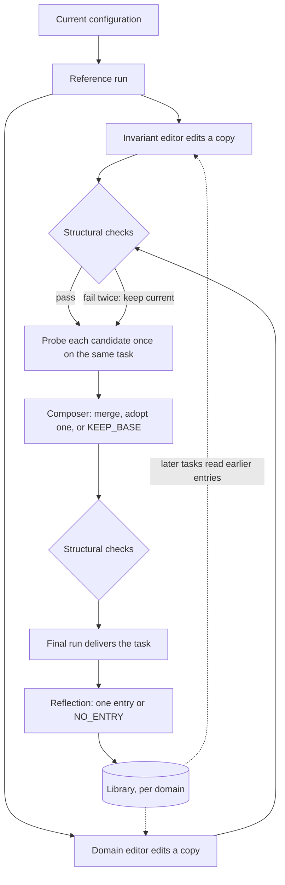

# 24 · Harness adaptation

[English](README.md) · [繁體中文](README.zh-TW.md) · **简体中文** · [日本語](README.ja.md) · [한국어](README.ko.md)

> 就算没有 grader，improver 也能根据 agent 自己跑出来的 run，调整它的 configuration。

第 21 章的改进 loop 默认手上有 checker：一份 rubric、一组 regression 测试、一份 holdout set。
第 0 章换个角度讲了同一件事：结果没办法交给机器检查时，要么补一个 checker，要么让人留在流程里。

开放式任务两种做法都套不上。这类任务一次只来一个，也没有标准答案。成果交出去之前，手上没有任何东西可以拿来打分。

[harness²](https://github.com/google-research/harness2) 试的是第三种做法。它本身不是 agent harness。
它自己不跑 loop，而是启动一个现成的 coding agent 当 executor，再去改这个 agent 的 configuration 文件。

它先用当前的 configuration 跑一次，再让几个独立的 session 各改一份副本，每份副本都在同一个任务上跑一次，最后只留下 run 结果支持的改动。
从 run 看得出一份 configuration 实际上怎么做事，但看不出答案到底对不对。

代价是每个任务要多跑好几次，而且结果对不对，没有任何保证。

---

## 核心机制



最简单的版本只走一步（k = 1）：

1. **Reference run：** executor 用当前的 configuration 把任务跑一次。
2. **提议（Propose）：** 两个 editor 各自开一个 session，各改一份副本。invariant editor 管 agent 怎么做事：步骤、tool 的用法、script、subagent。
   domain editor 管这一行的人会懂的东西：领域知识和 skill。prompt 会要求每个 editor，每一处改动都要指出是 run 里的哪个时刻让它这样改。
3. **检查（Check）：** 每份副本都要跑一遍结构检查（见下一小节）。
4. **Probe：** 每个 candidate（改好的副本）用同一个 model、在同一个环境里，把同一个任务跑一次。
5. **合并（Compose）：** 一个 session（composer）读 reference run，以及每个 candidate 的 diff 和 probe 结果。
   它可以把有证据支持的改动合在一起、直接采用其中一个 candidate，或回答 `KEEP_BASE`，表示维持原样。
   prompt 也会提醒 composer：只跑一次的 probe 是很弱的证据；如果有好几次 reference run，只在其中一次出现的毛病就当成噪音。
   composer 的输出也要走同一套检查、重试和回退。
6. **交付（Deliver）：** 用合并后的 configuration 跑出来的那次 run，就是要交出去的成果。

k = 1 时，这一步会花掉四次 executor run 和三个负责修改的 session（两个 editor、一个 composer）。如果有保留 library，再加一个 reflection session。

这套流程里的各个部分：

- **Executor：** 实际做任务的 agent，本身固定不动：它的 loop、tool 和权重都不会改。
- **Configuration：** executor 那些可以修改的文件。
- **Improver：** 也就是那些 editor 和 composer。每一个都是独立的 session，只改副本，从来不碰正在使用的文件。
- **Selector：** k > 1 时，负责从好几个最终版本里挑一个的 session。
- **Reflector：** 把这个任务学到的东西写进 library 的 session，也可以选择什么都不写。
- **Edit surface：** improver 可以改的那些文件。
- **Probe：** 拿一个 candidate 在同一个任务上跑一次。看的是它跟其他 run 哪里不一样，从来不当成分数。
- **Library：** 每个领域各自一个存储区，存着被采用过的 configuration，每一份都附一条教训。

### 添加：edit surface 和它的检查

configuration 由八个部分组成，每个部分在这个 repo 里都有专门讲它的章节：

| 组成部分 | 对应章节 |
| --- | --- |
| System prompt | 10 |
| Guardrails（每次都会加载的文字规则，不像权限检查那样真的会拦下操作） | 10 |
| Memory 文件 | 9 |
| Tool 使用说明 | 2 |
| Subagent | 6 |
| Skill | 7 |
| Script | 2 |
| Plugin 或 hook | 4 |

- **edit surface 写成数据：** 每个 executor 自己声明自己的 edit surface。其中一个 executor 有四个常驻文件（每次都会加载的文件），另外还有 plugin。
  另一个则只有一个比较小的常驻文件，没有 plugin，改用一个 hooks 文件。
- **improver 只改副本：** 它在自己的工作区里做事，最后只有改好的 configuration 文件夹会拿回来。
  这套方法自己的 prompt 和 gate 从来不会复制进去，所以 improver 改不到它们。
- **检查在任何 probe 之前跑：** 副本只要有下面任何一种情况，就算不合格：
  - 里面有 edit surface 以外的文件（整份副本退回，跟其他不合格的副本一样处理）；
  - 常驻文字超过长度上限；
  - 某个 skill 没写 description，或常驻文字从来没提到它；
  - 某个 script 编译不过（script 只会被编译，从来不会被执行）；
  - 某个 skill 提到的 script 没有一起附上；
  - hooks 文件绑定了 executor 根本不会发出的事件；
  - 里面带有 grader 的判定文字（这条是 tripwire，一出现就拦下）。
- **有一项检查会先修一次：** 常驻文字没提到某个 skill 时，只要长度上限还容得下，harness² 会先替它补一行 trigger（说明什么时候该用这个 skill）。
  补完之后才跑这项检查，所以只有补不进去时才会失败。
- **有些规则只是写在 prompt 里的要求：** prompt 要求 improver 按运行时的成本，决定每个改动放在哪里：能放进 skill 或 script 的，就不要放进常驻文字。
  没有任何检查会确认它真的照做。
- **不合格的副本有一次重试机会：** validator（也就是下面代码里的 `check`）的错误信息会带进重试。第二次还是不合格，就保留现有的 configuration，记成「被迫回退」。
  合格但没有任何改动的副本，另外记成「主动保留」。

```python
def run_stage(editor, config, attempts=2):            # src/adapt.py
    feedback = None
    for n in range(1, attempts + 1):
        out = editor(dict(config), feedback)
        out = dict(config) if out == KEEP_BASE else out
        try:
            check(out)                                 # one ValueError lists every problem
        except ValueError as e:
            feedback = str(e)                          # the message rides into the retry
            continue
        return {"config": out, "fell_back": False, "kept_base": out == config, "attempts": n, "error": None}
    return {"config": dict(config), "fell_back": True, "kept_base": False, "attempts": attempts, "error": feedback}
```

edit surface 甚至碰得到 loop 里的控制。其中一个 executor 的 hooks 文件可以修改，能绑定 `PreToolUse` 和 `PermissionRequest`（第 4 章）。
所以一个改动，就可能改变 executor 怎么替自己的 tool 调用把关。第 21 章说 gate 要放在 loop 能改的范围之外，这条规则也得涵盖这种情况。

### 添加：同一个 budget，要花在广度还是深度

budget 就是 k。有两种模式可以花它：

- **并行（Parallel）：** 从同一批 reference run 产生 2k 个 candidate，每个都 probe 一次。接着做 k 次彼此独立的合并，每次合并的结果也各 probe 一次。
- **顺序（Sequential）：** 跑 k 轮。每一轮都针对当前的 checkpoint（到这一轮为止的 configuration）提出两个 candidate，两个都 probe，再合并出下一个 checkpoint，并 probe 它。
  在顺序模式里，`KEEP_BASE` 保留的是当前的 checkpoint，不会退回最初的版本。

两种模式都刚好花掉 4k 次 executor run 和 3k 个负责修改的 session（editor 加 composer），其中包含 k 次共用的 reference run。
某个阶段就算被迫回退，也照样计入、照样要 probe，所以失败不会让花费变少。最后的挑选和 reflection 不算在这个数字里。

k = 1 时，两种模式其实都是前面那一步，不需要挑选。k > 1 时，selector 会在不知道来源的情况下，只从 k 个最终版本里挑一个。
并行模式的最终版本，就是那 k 次合并的结果。顺序模式则是每一个 checkpoint 都算，不只最后一个。

- selector 看得到任务、原始文件，以及每个最终版本交出的成果，但每份成果只标着一个打乱过的 id。它看不到任何 configuration，也看不到任何标签。
- 只有当成果是某种状态、没有文件可以给它看时，它才看得到 run log。
- 它只能挑一份已经存在的输出。被挑中只代表被采用，证明不了什么。

没有任何规则会替你选模式。模式和 k 都在开跑前就定好了。

### 添加：跨任务学习

一个任务结束后，reflection session 会读过每个 candidate 的 diff 和 probe、做决定时留下的说明，以及最后挑中了哪个最终版本。
它会写下一条记录：整份被采用的 configuration，加上一条教训。教训包含 cue（遇到什么情况该想起它）、教训本身、证据和置信度。
它也会给每一处改动下判定：有帮助、有害、看不出效果，或是 confounded（同一次 probe 里改了好几处，分不出是哪一处造成的）。

- **被采用不等于有证据：** 挑选时比的是输出，configuration 都藏起来了。所以挑选结果只说明哪份输出看起来最好，说明不了是哪个改动起了作用。
- **记录要过 gate 才写得进去：** `NO_ENTRY` 是合法的回答。缺了 cue、教训或证据的记录，一律不会写入。挑选失败的话，就跳过 reflection，什么都不存。
- **每个领域一个 library：** 同一个领域的任务按顺序跑，每个任务只读得到更早的任务留下的记录。
  索引列出每条记录包含哪些组成部分，以及它的 cue。improver 觉得哪条相关，就打开哪条（第 9 章先看索引、选中了才读全文的 recall 做法）。
- **重用就是复制过来，再 probe 一次：** 每个任务都从 base configuration（还没改过的原始版本）开始。
  存下来的组成部分要进到新任务，只有一种方式：editor 把它复制进某个 candidate，而这个 candidate 跟其他改动一样要检查、要 probe。
  更早的任务得到的事实，到了这里只算一个假设。
- **每组实验条件各一个 library：** benchmark、executor、k、seed 和模式的每一种组合，都有自己的 library。

### 如何集成到现有架构

- 第 21 章「在线执行，离线学习」的原则不用改写，照样成立。executor 的 run 从来不修改任何东西。improver 是独立的 session，读过好几次 run，再去改一份副本。
  被采用的副本只用在这一个任务，下一个任务又从 base 开始。要把东西带到下一个任务，只能通过 library。
- 说白了：这里没有 holdout set，也没有 regression 测试集。把关靠的只有结构检查，加上在同一个任务上跑的一次 probe。
- 第 23 章：这套方法里，没有任何 session 会拿到 rubric、分数或 verifier 的输出。
  但网络如果是开着的，executor 下载的 rubric 还是会通过 run log 传到 editor 手上（第 23 章「受测的 agent 自己去抓 rubric」那个问题）。
  方法之外另有一个 judge，等挑选结束之后，才给被挑中的 run 打分。
  它也可以给 reference run 打分，但只能当成另一条独立的 baseline，而且它写下的任何东西都不会流回这套方法。
- 第 3 章：executor 的沙箱和网络策略都放在 configuration 之外。

harness² 对这些部分有自己的叫法。这个 repo 还是用自己的用语，对照如下：

| harness² 的用语 | 本 repo 的用语 |
| --- | --- |
| harnessing | 改进 loop（第 21 章） |
| execution harness | configuration |
| improvement harness | improver 那几份固定的 prompt，加上它的 library |
| task-level recursion | 同一个任务内的调整 |
| harnessing-level recursion | 任务与任务之间的 library 更新 |
| Propose, Probe, Compose | 一步：提议、probe，再合并或保留 |
| substrate | executor |
| rollout | reference run 或 probe |
| harness improvement library | library |

---

## 不同系统怎么做

各个系统怎么根据过去的 session，修改 agent 的 configuration。没有一个会在改动生效之前，先拿任务 probe 一次。

| | Claude Code | Hermes Agent | deepseek-harness |
| --- | --- | --- | --- |
| **优点** | 写下的笔记从下一个 session 就派上用场，不必多跑任何一次。 | 做了很多事的 session 会自动拿来学，不用另外配置。 | 正在跑的 session，用的配置不会中途被改掉。 |
| **限制** | 笔记没经过任何测试，之后的 session 就直接加载。 | 改动没先实际跑过一次，之后的 session 就直接加载。 | 新的 preset 写好后，没有任何东西会拿它实际跑一个任务。 |
| **设计原因** | 用户纠正了什么、确认了什么，就是该留下的证据。 | model 光读 transcript，就判断得出一条教训好不好。 | agent 本身就是文件，所以也能交给另一个 agent 来写。 |
| **做法：who edits** | agent 自己，加上由 feature flag 控制的后台 fork。 | 正在跑的 agent、一个负责复查的 fork，以及每周跑一次的 curator。 | 有人提出要求时，由一个 authoring agent（专门写 preset 的 agent）来写。 |
| **做法：evidence** | 用户的纠正和确认。没有 probe，也没有分数。 | transcript 和使用次数。没有 probe。 | 没有证据，要靠人自己试用 preset。 |
| **做法：edit surface** | fork 只能写 memory 笔记。agent 本身什么文件都能改。 | skill 和 memory。fork 不会写入被 pin 住（锁定）的 skill。 | 一个 preset 文件夹。大部分限制只写成文字说明。 |
| **做法：checks** | 笔记完全不检查。要改设置、skill 或 subagent，得先经过批准。 | 检查格式、大小和路径。 | 实际挂载一次：preset 里的每一项都要找得到，也要能启动。 |
| **做法：carry over** | 笔记的索引，在同一个 repo 之后的每个 session 都会加载。 | 只有一个存储区，之后的每个 session 都会加载它。 | preset 用 id 挑选。新的 preset 一开始都是复制出来的。 |
| **做法：undo** | 没有版本记录。要撤销，只能由人自己改笔记。 | 每次 curator 跑之前，先给 skill 存一份快照。memory 没有快照。 | 正在跑的 session 继续用原来的 preset。要撤销，就再改一次。 |

---

## 常见问题

- **所有 candidate 共用一个错误前提（Candidates share a wrong premise）：** 每个 editor 读的是同样的 run，用的是同一个 model，所以可能全都接受同一个错误的假设。
  大家意见一致，看起来就像有证据支持。缓解：意见一致只能算支持，不能当成证明；再加一次 probe，专门测试这个共同的假设。
- **改动只凭一次走运的 probe（An edit chases one lucky probe）：** 每个 candidate 只跑一次，所以一次好或坏的结果，都可能只是噪音。
  缓解：好几次 reference run 里只出现一次的毛病，当成噪音；一次 probe 里同时改了好几处时，把改动标成 confounded；重用之前再 probe 一次。
- **被退回的改动卡住整个 run（A rejected edit stalls the run）：** 不合格的 configuration 如果没有回退机制，任务就会卡住，或一直等人来处理。
  缓解：把 validator 的错误信息带进一次重试，还是不行就保留现有的 configuration，并把「被迫回退」和「主动保留」分开记。
- **library 的记录夹带有害代码（A library entry carries a payload）：** 记录里存着 script 和 hook，复制过去的组成部分会在下一个任务的 executor 里执行。
  缓解：把记录当成不可信的内容（第 3 章）。prompt 会要求 improver 绝不能执行它读到的东西；复制过来的部分，也要跟新的改动一样过检查、跑 probe。
  每次 probe 都放在挡掉对外连接的沙箱里跑（第 3 章）。harness² 发布的版本没有提供这种沙箱。
- **improver 看到了分数（The improver sees the score）：** 证据里只要出现 rubric、分数或 verifier 的输出，测试集就成了训练信号。
  缓解：证据里不放任何答案、用 allowlist 限制哪些东西可以复制进来、设一道拦下判定文字的 tripwire、教训存进去之前先扫描，并替 executor 挡掉评分用的 host。

---

## 动手跑跑看

[`src/`](src/) 把 23 带了过来，并加上：

- [`adapt.py`](src/adapt.py)：独立的模块，没有接进 `loop.py`。configuration 是一个 dict，把路径映射到文字内容；`SURFACE` 记着允许的路径和常驻文字的长度上限。
  `check` 会抛出一个 `ValueError`，把所有问题一次列出来。`run_stage` 带着这段信息重试一次，还是不行就回退。
  `step` 跑 k = 1 的一步。`run_parallel` 和 `run_sequential` 返回 k 个最终版本，另外再返回一个 `Ledger`，确保花费刚好是 4k 次 run 和 3k 个 session。
  `Library` 的 `add` 要有 cue、教训和证据才会写入，它也维护一份索引；`retain` 会去掉比当前任务更晚的记录。
- [`test.py`](src/test.py)：离线检查每一条 `check` 规则、一次重试把坏掉的 script 修好（第二次的 prompt 里带着错误信息）、
  失败两次之后的回退，以及没有改动的副本会记成「主动保留」，而不是「被迫回退」。
  用行为固定的 editor 跑一步时，composer 看得到两份 diff 和两次 probe 的结果。
  `KEEP_BASE` 会原样返回输入；在顺序模式里，它保留的是当前的 checkpoint。
  测试也检查两种模式在 k = 1、2、3 时都刚好花掉 4k 次 run 和 3k 个 session、标签重复时 ledger 会报错、重试会多算一次尝试但不多算 session，
  以及 reference run 永远不会出现在最终版本里。
  library 这边，缺了 cue、教训或证据的记录不会写入，`NO_ENTRY` 也不会写入任何东西，而且每个任务只看得到更早的任务留下的记录。
- [`demo.py`](src/demo.py)：拿第 23 章的退款 episode，实际跑一次 k = 1 的一步。executor 就是 `run_turn`，system prompt 用的是 configuration 的常驻文字。
  每个 editor 和 composer 都是一次 model 调用。流程写在代码里，所有判断都交给 model。
  这一步跑完后，第 23 章的 `grade` 只给交出去的那次 run 打分；grader 出错时，就打印 UNGRADED。

`check` 比 harness² 严格。常驻文字没提到的 skill，这里不会先补一行，而是直接判定不合格。
demo 会跑四次 executor，所以刻意放宽了「每个 demo 只调用一次 `run_turn`」这条规则。原因是，这一整步本身就是要演示的机制。

loop 本身完全没改。调整改的是 loop 拿到的东西，从来不碰 loop 本身。

```bash
python sections/24-harness-adaptation/src/test.py         # offline checks, no key
uv run python sections/24-harness-adaptation/src/demo.py  # live demo, needs a key
```

---

## 参考资料

- [harness² source](https://github.com/google-research/harness2)（`1cfe254`，Apache-2.0）：`harness2/core/tree.py`（edit surface、检查）、
  `harness2/core/recursion.py`（一步、重试一次、并行与顺序模式）、`harness2/core/ledger.py`（4k 次 run、3k 个 session）、
  `harness2/core/selection.py`（盲选、reflection）、`harness2/core/library.py`（每个领域一个 library、只读更早的记录）、
  `harness2/core/schedule.py`（每个任务都从 base configuration 开始、领域内的任务顺序）、`harness2/cli/_common.py`（每组实验条件一个 library）、
  `harness2/core/context.py`（证据以文件形式提供、判定文字的 tripwire）、`harness2/core/proposer.py`（工作区里的副本）、
  `harness2/core/prompts.py`（默认的 `adapt` 这组 prompt：editor 各自负责的范围、composer 的规则、`KEEP_BASE`、`NO_ENTRY`）、
  `harness2/substrate/opencode.py` 和 `harness2/substrate/codex.py`（各个 executor 的 edit surface）。
- [harness² paper](https://arxiv.org/abs/2610.14224) v1：说明设计背后的理由（开放式任务没有标准答案、两个层次的改进、权重固定不动）。
  论文和代码不一致的地方，本章以代码为准。论文的 JobBench 实验用的是另一组 `tts` prompt；本章描述的是默认的 `adapt` 那一组。
  论文里的 benchmark 数字是作者自己报告的，这里不转述。
- [Claude Code source backup](https://github.com/yasasbanukaofficial/claude-code)（v2.1.88）：`memdir/`、`services/extractMemories/`、`services/autoDream/`、
  `utils/permissions/filesystem.ts`。后台 fork 由 feature flag 控制，普通用户默认有没有开启，目前还没有确认。
  只有内部才有的功能，以及这个版本之后才加入的功能，都没有写进来。
- [Hermes Agent source](https://github.com/NousResearch/hermes-agent)（v2026.7.1）：`agent/background_review.py`、`tools/skill_manager_tool.py`、
  `tools/memory_tool.py`、`agent/curator.py`、`agent/curator_backup.py`。
- [deepseek-harness source](https://github.com/deepseek-ai/deepseek-harness)（`dsh-v0.1.0-rc.7`）：`packages/preset/agent-presets/`
  （README、`src/mount.ts`、`src/authoring.ts`），以及 `apps/cli/config/agent-presets/` 里的 `cordis` authoring preset。
