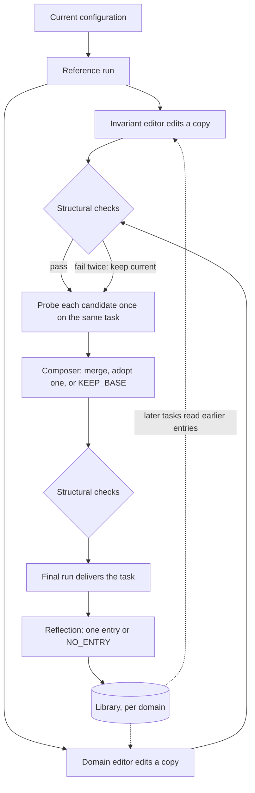

# 24 · Harness adaptation

[English](README.md) · **繁體中文** · [简体中文](README.zh-CN.md) · [日本語](README.ja.md) · [한국어](README.ko.md)

> 就算沒有 grader，improver 也能根據 agent 自己跑出來的 run，調整它的 configuration。

第 21 章的改進 loop 預設手上有 checker：一份 rubric、一組 regression 測試、一份 holdout set。
第 0 章換個角度講了同一件事：結果沒辦法交給機器檢查時，要嘛補一個 checker，要嘛讓人留在流程裡。

開放式任務兩種做法都套不上。這類任務一次只來一個，也沒有標準答案。成果交出去之前，手上沒有任何東西可以拿來打分。

[harness²](https://github.com/google-research/harness2) 試的是第三種做法。它本身不是 agent harness。
它自己不跑 loop，而是啟動一個現成的 coding agent 當 executor，再去改這個 agent 的 configuration 檔案。

它先用目前的 configuration 跑一次，再讓幾個獨立的 session 各改一份副本，每份副本都在同一個任務上跑一次，最後只留下 run 結果支持的改動。
從 run 看得出一份 configuration 實際上怎麼做事，但看不出答案到底對不對。

代價是每個任務要多跑好幾次，而且結果對不對，沒有任何保證。

---

## 核心機制



最簡單的版本只走一步（k = 1）：

1. **Reference run：** executor 用目前的 configuration 把任務跑一次。
2. **提議（Propose）：** 兩個 editor 各自開一個 session，各改一份副本。invariant editor 管 agent 怎麼做事：步驟、tool 的用法、script、subagent。
   domain editor 管這一行的人會懂的東西：領域知識和 skill。prompt 會要求每個 editor，每一處改動都要指出是 run 裡的哪個時刻讓它這樣改。
3. **檢查（Check）：** 每份副本都要跑一遍結構檢查（見下一小節）。
4. **Probe：** 每個 candidate（改好的副本）用同一個 model、在同一個環境裡，把同一個任務跑一次。
5. **合併（Compose）：** 一個 session（composer）讀 reference run，以及每個 candidate 的 diff 和 probe 結果。
   它可以把有證據支持的改動合在一起、直接採用其中一個 candidate，或回答 `KEEP_BASE`，表示維持原樣。
   prompt 也會提醒 composer：只跑一次的 probe 是很弱的證據；如果有好幾次 reference run，只在其中一次出現的毛病就當成雜訊。
   composer 的輸出也要走同一套檢查、重試和回退。
6. **交付（Deliver）：** 用合併後的 configuration 跑出來的那次 run，就是要交出去的成果。

k = 1 時，這一步會花掉四次 executor run 和三個負責修改的 session（兩個 editor、一個 composer）。如果有保留 library，再加一個 reflection session。

這套流程裡的各個部分：

- **Executor：** 實際做任務的 agent，本身固定不動：它的 loop、tool 和權重都不會改。
- **Configuration：** executor 那些可以修改的檔案。
- **Improver：** 也就是那些 editor 和 composer。每一個都是獨立的 session，只改副本，從來不碰正在使用的檔案。
- **Selector：** k > 1 時，負責從好幾個最終版本裡挑一個的 session。
- **Reflector：** 把這個任務學到的東西寫進 library 的 session，也可以選擇什麼都不寫。
- **Edit surface：** improver 可以改的那些檔案。
- **Probe：** 拿一個 candidate 在同一個任務上跑一次。看的是它跟其他 run 哪裡不一樣，從來不當成分數。
- **Library：** 每個領域各自一個儲存區，存著被採用過的 configuration，每一份都附一條教訓。

### 新增：edit surface 和它的檢查

configuration 由八個部分組成，每個部分在這個 repo 裡都有專門講它的章節：

| 組成部分 | 對應章節 |
| --- | --- |
| System prompt | 10 |
| Guardrails（每次都會載入的文字規則，不像權限檢查會真的擋下操作） | 10 |
| Memory 檔案 | 9 |
| Tool 使用說明 | 2 |
| Subagent | 6 |
| Skill | 7 |
| Script | 2 |
| Plugin 或 hook | 4 |

- **edit surface 寫成資料：** 每個 executor 自己宣告自己的 edit surface。其中一個 executor 有四個常駐檔案（每次都會載入的檔案），另外還有 plugin。
  另一個則只有一個比較小的常駐檔案，沒有 plugin，改用一個 hooks 檔案。
- **improver 只改副本：** 它在自己的工作區裡做事，最後只有改好的 configuration 資料夾會拿回來。
  這套方法自己的 prompt 和 gate 從來不會複製進去，所以 improver 改不到它們。
- **檢查在任何 probe 之前跑：** 副本只要有下面任何一種情況，就算不合格：
  - 裡面有 edit surface 以外的檔案（整份副本退回，跟其他不合格的副本一樣處理）；
  - 常駐文字超過長度上限；
  - 某個 skill 沒寫 description，或常駐文字從來沒提到它；
  - 某個 script 編譯不過（script 只會被編譯，從來不會被執行）；
  - 某個 skill 提到的 script 沒有一起附上；
  - hooks 檔案綁定了 executor 根本不會發出的事件；
  - 裡面帶有 grader 的判定文字（這條是 tripwire，一出現就擋下）。
- **有一項檢查會先修一次：** 常駐文字沒提到某個 skill 時，只要長度上限還容得下，harness² 會先替它補一行 trigger（說明什麼時候該用這個 skill）。
  補完之後才跑這項檢查，所以只有補不進去時才會失敗。
- **有些規則只是寫在 prompt 裡的要求：** prompt 要求 improver 依執行時的成本，決定每個改動放在哪裡：能放進 skill 或 script 的，就不要放進常駐文字。
  沒有任何檢查會確認它真的照做。
- **不合格的副本有一次重試機會：** validator（也就是下面程式裡的 `check`）的錯誤訊息會帶進重試。第二次還是不合格，就保留現有的 configuration，記成「被迫回退」。
  合格但沒有任何改動的副本，另外記成「主動保留」。

```python
def run_stage(editor, config, attempts=2):            # src/adapt.py
    feedback = None
    for n in range(1, attempts + 1):
        out = editor(dict(config), feedback)
        out = dict(config) if out == KEEP_BASE else out
        try:
            check(out)                                 # one ValueError lists every problem
        except ValueError as e:
            feedback = str(e)                          # the message rides into the retry
            continue
        return {"config": out, "fell_back": False, "kept_base": out == config, "attempts": n, "error": None}
    return {"config": dict(config), "fell_back": True, "kept_base": False, "attempts": attempts, "error": feedback}
```

edit surface 甚至碰得到 loop 裡的控制。其中一個 executor 的 hooks 檔案可以修改，能綁定 `PreToolUse` 和 `PermissionRequest`（第 4 章）。
所以一個改動，就可能改變 executor 怎麼替自己的 tool 呼叫把關。第 21 章說 gate 要放在 loop 能改的範圍之外，這條規則也得涵蓋這種情況。

### 新增：同一個 budget，要花在廣度還是深度

budget 就是 k。有兩種模式可以花它：

- **平行（Parallel）：** 從同一批 reference run 產生 2k 個 candidate，每個都 probe 一次。接著做 k 次彼此獨立的合併，每次合併的結果也各 probe 一次。
- **依序（Sequential）：** 跑 k 輪。每一輪都針對目前的 checkpoint（到這一輪為止的 configuration）提出兩個 candidate，兩個都 probe，再合併出下一個 checkpoint，並 probe 它。
  在依序模式裡，`KEEP_BASE` 保留的是目前的 checkpoint，不會退回最初的版本。

兩種模式都剛好花掉 4k 次 executor run 和 3k 個負責修改的 session（editor 加 composer），其中包含 k 次共用的 reference run。
某個階段就算被迫回退，也照樣計入、照樣要 probe，所以失敗不會讓花費變少。最後的挑選和 reflection 不算在這個數字裡。

k = 1 時，兩種模式其實都是前面那一步，不需要挑選。k > 1 時，selector 會在不知道來源的情況下，只從 k 個最終版本裡挑一個。
平行模式的最終版本，就是那 k 次合併的結果。依序模式則是每一個 checkpoint 都算，不只最後一個。

- selector 看得到任務、原始檔案，以及每個最終版本交出的成果，但每份成果只標著一個打亂過的 id。它看不到任何 configuration，也看不到任何標籤。
- 只有當成果是某種狀態、沒有檔案可以給它看時，它才看得到 run log。
- 它只能挑一份已經存在的輸出。被挑中只代表被採用，證明不了什麼。

沒有任何規則會替你選模式。模式和 k 都在開跑前就定好了。

### 新增：跨任務學習

一個任務結束後，reflection session 會讀過每個 candidate 的 diff 和 probe、做決定時留下的說明，以及最後挑中了哪個最終版本。
它會寫下一筆紀錄：整份被採用的 configuration，加上一條教訓。教訓包含 cue（遇到什麼情況該想起它）、教訓本身、證據和信心程度。
它也會替每一處改動下判定：有幫助、有害、看不出效果，或是 confounded（同一次 probe 裡改了好幾處，分不出是哪一處造成的）。

- **被採用不等於有證據：** 挑選時比的是輸出，configuration 都藏起來了。所以挑選結果只說明哪份輸出看起來最好，說明不了是哪個改動起了作用。
- **紀錄要過 gate 才寫得進去：** `NO_ENTRY` 是合法的回答。缺了 cue、教訓或證據的紀錄，一律不會寫入。挑選失敗的話，就跳過 reflection，什麼都不存。
- **每個領域一個 library：** 同一個領域的任務照順序跑，每個任務只讀得到更早的任務留下的紀錄。
  索引列出每筆紀錄包含哪些組成部分，以及它的 cue。improver 覺得哪筆相關，就打開哪筆（第 9 章先看索引、選中了才讀全文的 recall 做法）。
- **重用就是複製過來，再 probe 一次：** 每個任務都從 base configuration（還沒改過的原始版本）開始。
  存下來的組成部分要進到新任務，只有一種方式：editor 把它複製進某個 candidate，而這個 candidate 跟其他改動一樣要檢查、要 probe。
  更早的任務得到的事實，到了這裡只算一個假設。
- **每組實驗條件各一個 library：** benchmark、executor、k、seed 和模式的每一種組合，都有自己的 library。

### 如何接進現有架構

- 第 21 章「線上執行，離線學習」的原則不用改寫，照樣成立。executor 的 run 從來不修改任何東西。improver 是獨立的 session，讀過好幾次 run，再去改一份副本。
  被採用的副本只用在這一個任務，下一個任務又從 base 開始。要把東西帶到下一個任務，只能透過 library。
- 說白了：這裡沒有 holdout set，也沒有 regression 測試集。把關靠的只有結構檢查，加上在同一個任務上跑的一次 probe。
- 第 23 章：這套方法裡，沒有任何 session 會拿到 rubric、分數或 verifier 的輸出。
  但網路如果是開的，executor 下載的 rubric 還是會透過 run log 傳到 editor 手上（第 23 章「受測的 agent 自己去抓 rubric」那個問題）。
  方法之外另有一個 judge，等挑選結束之後，才替被挑中的 run 打分。
  它也可以替 reference run 打分，但只能當成另一條獨立的 baseline，而且它寫下的任何東西都不會流回這套方法。
- 第 3 章：executor 的沙箱和網路政策都放在 configuration 之外。

harness² 對這些部分有自己的叫法。這個 repo 還是用自己的用語，對照如下：

| harness² 的用語 | 本 repo 的用語 |
| --- | --- |
| harnessing | 改進 loop（第 21 章） |
| execution harness | configuration |
| improvement harness | improver 那幾份固定的 prompt，加上它的 library |
| task-level recursion | 同一個任務內的調整 |
| harnessing-level recursion | 任務與任務之間的 library 更新 |
| Propose, Probe, Compose | 一步：提議、probe，再合併或保留 |
| substrate | executor |
| rollout | reference run 或 probe |
| harness improvement library | library |

---

## 不同系統怎麼做

各個系統怎麼根據過去的 session，修改 agent 的 configuration。沒有一個會在改動生效之前，先拿任務 probe 一次。

| | Claude Code | Hermes Agent | deepseek-harness |
| --- | --- | --- | --- |
| **優點** | 寫下的筆記從下一個 session 就派上用場，不必多跑任何一次。 | 做了很多事的 session 會自動拿來學，不用另外設定。 | 正在跑的 session，用的設定不會中途被改掉。 |
| **限制** | 筆記沒經過任何測試，之後的 session 就直接載入。 | 改動沒先實際跑過一次，之後的 session 就直接載入。 | 新的 preset 寫好後，沒有任何東西會拿它實際跑一個任務。 |
| **設計原因** | 使用者糾正了什麼、確認了什麼，就是該留下的證據。 | model 光讀 transcript，就判斷得出一條教訓好不好。 | agent 本身就是檔案，所以也能交給另一個 agent 來寫。 |
| **做法：who edits** | agent 自己，加上由 feature flag 控制的背景 fork。 | 正在跑的 agent、一個負責複查的 fork，以及每週跑一次的 curator。 | 有人提出要求時，由一個 authoring agent（專門寫 preset 的 agent）來寫。 |
| **做法：evidence** | 使用者的糾正和確認。沒有 probe，也沒有分數。 | transcript 和使用次數。沒有 probe。 | 沒有證據，要靠人自己試用 preset。 |
| **做法：edit surface** | fork 只能寫 memory 筆記。agent 本身什麼檔案都能改。 | skill 和 memory。fork 不會寫入被 pin 住（鎖定）的 skill。 | 一個 preset 資料夾。大部分限制只寫成文字說明。 |
| **做法：checks** | 筆記完全不檢查。要改設定、skill 或 subagent，得先經過核准。 | 檢查格式、大小和路徑。 | 實際掛載一次：preset 裡的每一項都要找得到，也要能啟動。 |
| **做法：carry over** | 筆記的索引，在同一個 repo 之後的每個 session 都會載入。 | 只有一個儲存區，之後的每個 session 都會載入它。 | preset 用 id 挑選。新的 preset 一開始都是複製出來的。 |
| **做法：undo** | 沒有版本紀錄。要復原，只能由人自己改筆記。 | 每次 curator 跑之前，先替 skill 存一份快照。memory 沒有快照。 | 正在跑的 session 繼續用原本的 preset。要復原，就再改一次。 |

---

## 常見問題

- **所有 candidate 共用一個錯誤前提（Candidates share a wrong premise）：** 每個 editor 讀的是同樣的 run，用的是同一個 model，所以可能全都接受同一個錯誤的假設。
  大家意見一致，看起來就像有證據支持。緩解：意見一致只能算支持，不能當成證明；再加一次 probe，專門測試這個共同的假設。
- **改動只憑一次走運的 probe（An edit chases one lucky probe）：** 每個 candidate 只跑一次，所以一次好或壞的結果，都可能只是雜訊。
  緩解：好幾次 reference run 裡只出現一次的毛病，當成雜訊；一次 probe 裡同時改了好幾處時，把改動標成 confounded；重用之前再 probe 一次。
- **被退回的改動卡住整個 run（A rejected edit stalls the run）：** 不合格的 configuration 如果沒有回退機制，任務就會卡住，或一直等人來處理。
  緩解：把 validator 的錯誤訊息帶進一次重試，還是不行就保留現有的 configuration，並把「被迫回退」和「主動保留」分開記。
- **library 的紀錄夾帶有害程式碼（A library entry carries a payload）：** 紀錄裡存著 script 和 hook，複製過去的組成部分會在下一個任務的 executor 裡執行。
  緩解：把紀錄當成不可信的內容（第 3 章）。prompt 會要求 improver 絕不能執行它讀到的東西；複製過來的部分，也要跟新的改動一樣過檢查、跑 probe。
  每次 probe 都放在擋掉對外連線的沙箱裡跑（第 3 章）。harness² 釋出的版本沒有提供這種沙箱。
- **improver 看到了分數（The improver sees the score）：** 證據裡只要出現 rubric、分數或 verifier 的輸出，測試集就成了訓練訊號。
  緩解：證據裡不放任何答案、用 allowlist 限制哪些東西可以複製進來、設一道擋下判定文字的 tripwire、教訓存進去之前先掃描，並替 executor 擋掉評分用的 host。

---

## 動手跑跑看

[`src/`](src/) 把 23 帶了過來，並加上：

- [`adapt.py`](src/adapt.py)：獨立的模組，沒有接進 `loop.py`。configuration 是一個 dict，把路徑對到文字內容；`SURFACE` 記著允許的路徑和常駐文字的長度上限。
  `check` 會丟出一個 `ValueError`，把所有問題一次列出來。`run_stage` 帶著這段訊息重試一次，還是不行就回退。
  `step` 跑 k = 1 的一步。`run_parallel` 和 `run_sequential` 回傳 k 個最終版本，另外再回傳一個 `Ledger`，確保花費剛好是 4k 次 run 和 3k 個 session。
  `Library` 的 `add` 要有 cue、教訓和證據才會寫入，它也維護一份索引；`retain` 會去掉比目前任務更晚的紀錄。
- [`test.py`](src/test.py)：離線檢查每一條 `check` 規則、一次重試把壞掉的 script 修好（第二次的 prompt 裡帶著錯誤訊息）、
  失敗兩次之後的回退，以及沒有改動的副本會記成「主動保留」，而不是「被迫回退」。
  用行為固定的 editor 跑一步時，composer 看得到兩份 diff 和兩次 probe 的結果。
  `KEEP_BASE` 會原樣回傳輸入；在依序模式裡，它保留的是目前的 checkpoint。
  測試也檢查兩種模式在 k = 1、2、3 時都剛好花掉 4k 次 run 和 3k 個 session、標籤重複時 ledger 會報錯、重試會多算一次嘗試但不多算 session，
  以及 reference run 永遠不會出現在最終版本裡。
  library 這邊，缺了 cue、教訓或證據的紀錄不會寫入，`NO_ENTRY` 也不會寫入任何東西，而且每個任務只看得到更早的任務留下的紀錄。
- [`demo.py`](src/demo.py)：拿第 23 章的退款 episode，實際跑一次 k = 1 的一步。executor 就是 `run_turn`，system prompt 用的是 configuration 的常駐文字。
  每個 editor 和 composer 都是一次 model 呼叫。流程寫在程式碼裡，所有判斷都交給 model。
  這一步跑完後，第 23 章的 `grade` 只替交出去的那次 run 打分；grader 出錯時，就印出 UNGRADED。

`check` 比 harness² 嚴格。常駐文字沒提到的 skill，這裡不會先補一行，而是直接判定不合格。
demo 會跑四次 executor，所以刻意放寬了「每個 demo 只呼叫一次 `run_turn`」這條規則。原因是，這一整步本身就是要示範的機制。

loop 本身完全沒改。調整改的是 loop 拿到的東西，從來不碰 loop 本身。

```bash
python sections/24-harness-adaptation/src/test.py         # offline checks, no key
uv run python sections/24-harness-adaptation/src/demo.py  # live demo, needs a key
```

---

## 參考資料

- [harness² source](https://github.com/google-research/harness2)（`1cfe254`，Apache-2.0）：`harness2/core/tree.py`（edit surface、檢查）、
  `harness2/core/recursion.py`（一步、重試一次、平行與依序模式）、`harness2/core/ledger.py`（4k 次 run、3k 個 session）、
  `harness2/core/selection.py`（盲選、reflection）、`harness2/core/library.py`（每個領域一個 library、只讀更早的紀錄）、
  `harness2/core/schedule.py`（每個任務都從 base configuration 開始、領域內的任務順序）、`harness2/cli/_common.py`（每組實驗條件一個 library）、
  `harness2/core/context.py`（證據以檔案形式提供、判定文字的 tripwire）、`harness2/core/proposer.py`（工作區裡的副本）、
  `harness2/core/prompts.py`（預設的 `adapt` 這組 prompt：editor 各自負責的範圍、composer 的規則、`KEEP_BASE`、`NO_ENTRY`）、
  `harness2/substrate/opencode.py` 和 `harness2/substrate/codex.py`（各個 executor 的 edit surface）。
- [harness² paper](https://arxiv.org/abs/2610.14224) v1：說明設計背後的理由（開放式任務沒有標準答案、兩個層次的改進、權重固定不動）。
  論文和程式碼不一致的地方，本章以程式碼為準。論文的 JobBench 實驗用的是另一組 `tts` prompt；本章描述的是預設的 `adapt` 那一組。
  論文裡的 benchmark 數字是作者自己回報的，這裡不轉述。
- [Claude Code source backup](https://github.com/yasasbanukaofficial/claude-code)（v2.1.88）：`memdir/`、`services/extractMemories/`、`services/autoDream/`、
  `utils/permissions/filesystem.ts`。背景 fork 由 feature flag 控制，一般使用者預設有沒有開啟，目前還沒有確認。
  只有內部才有的功能，以及這個版本之後才加入的功能，都沒有寫進來。
- [Hermes Agent source](https://github.com/NousResearch/hermes-agent)（v2026.7.1）：`agent/background_review.py`、`tools/skill_manager_tool.py`、
  `tools/memory_tool.py`、`agent/curator.py`、`agent/curator_backup.py`。
- [deepseek-harness source](https://github.com/deepseek-ai/deepseek-harness)（`dsh-v0.1.0-rc.7`）：`packages/preset/agent-presets/`
  （README、`src/mount.ts`、`src/authoring.ts`），以及 `apps/cli/config/agent-presets/` 裡的 `cordis` authoring preset。
